# WeekRail（周轨）大学生课表工具

Windows 桌面课表横条：置顶显示当天课程（支持鼠标穿透降低不透明度），按大学周次排课，支持假期、文字课表、ICS 导入与多套课表来源切换。


> 横条预览使用虚构课程数据。

## 功能

- **顶部横条**：`第X周 · 日期 · 周几` + 13 节课逐节显示；科目配色、连堂合并、空节灰横杠、圆角卡片。
- **置顶与穿透**：始终置顶（其他窗口抢置顶后 1 秒内自动恢复），鼠标穿透，悬停自动变淡。
- **课表管理**：科目 / 课表增删改、冲突检测、按 `科目 + 星期 + 节次` 精确删除。
- **ICS 导入**：BitUp（哔特）、BIT101 等导出的 `.ics` 直接导入；导入后可逐门编辑横条简称。
- **多课表来源**：手动课表与多个 ICS 课表各自独立保存，随时切换，互不覆盖。
- **假期**：手动添加 / 删除假期段；整天没课的日子自动显示「今日假期」。
- **学期周次**：可把第 1 周重定义到另一个周一，之前的周显示为 `第-1周`、`第-2周`……
- **文字课表**：`[7]` 按课程输出自然语言描述（自动合并周次 / 星期 / 节次）。
- **托盘与自启**：单个托盘图标；终端最小化后自动隐藏；`autostart.bat` 适合开机自启。

## 快速开始

1. 安装 **64 位 Python 3.10+**（勾选 *Add Python to PATH*）。
2. 安装依赖：

   ```powershell
   pip install -r requirements.txt
   ```

   报 `from versions: none` 或下载很慢时，换阿里云源：

   ```powershell
   pip install -r requirements.txt -i https://mirrors.aliyun.com/pypi/simple/
   ```

> 注：清华源在部分机器上命中不了正确的包，如出现 `from versions: none`，请更换阿里云源重试。

3. 双击 **`launcher.bat`**。
4. 首次启动选 `i`（导入 ICS）或 `m`（手动创建）。

> **重要：若选择 `i`（导入 ICS），请在项目根目录的 `课表ics` 文件夹中放入 ICS 文件；没有该文件夹时程序会自动创建，并提示完整路径。**

5. 选 `[3] 显示横条`，之后用托盘图标及右键菜单控制。若找不到托盘图标，点击展开按钮。

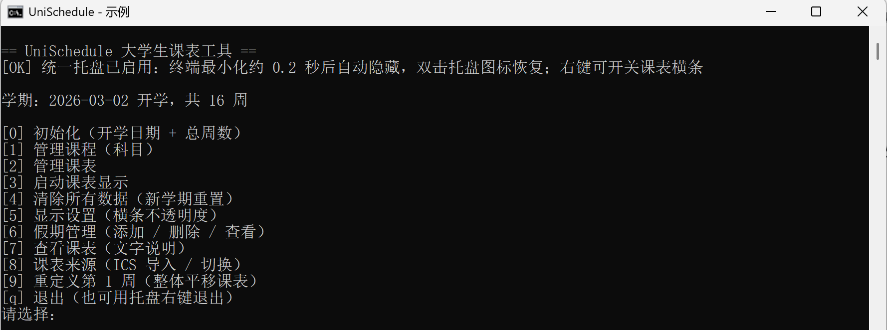
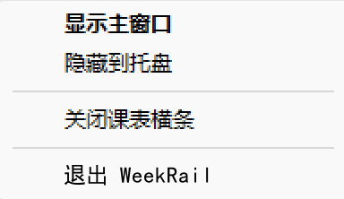

> 注：如果点击托盘菜单按键无反应，请点击托盘图标打开主窗口，确认是否有正在等待输入的二级菜单。只有回到如“主菜单”图类似的界面，托盘菜单的按键方可正常点击响应。
> **重要：当前窗口点击最小化，会自动隐藏到托盘；点击关闭，即结束 WeekRail 主程序！**

## 菜单一览

| 菜单    | 功能                              |
| ----- | ------------------------------- |
| `[0]` | 初始化（开学日期 + 总周数）                 |
| `[1]` | 管理课程（科目全名 / 简称 / 颜色）            |
| `[2]` | 管理课表（录入、冲突检测、删除整条、精确删除）         |
| `[3]` | 启动课表显示（可输入模拟日期）                 |
| `[4]` | 清除所有数据（所有课表来源 + 假期）             |
| `[5]` | 显示设置（非假期 / 假期 × 正常 / 悬停 四档不透明度） |
| `[6]` | 假期管理（添加 / 删除 / 查看）              |
| `[7]` | 查看课表（文字说明）                      |
| `[8]` | 课表来源（ICS 导入 / 切换 / 查看 / 删除）     |
| `[9]` | 重定义第 1 周（整体平移课表）                |
| `q`   | 退出                              |

### [0] 初始化

设置学期的第 1 周周一（日期）与总周数。导入 ICS 的来源会自带学期设置，可在 `[8]` 里查看。

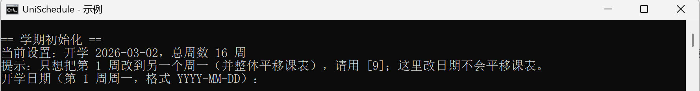

### [1] 管理课程

`[1]` 是录入课表的前置步骤：先建立科目（全名、横条简称、颜色），`[2]` 才能按科目录入课表。
支持新建 / 编辑 / 删除；删除科目会同时删除它的课表条目。

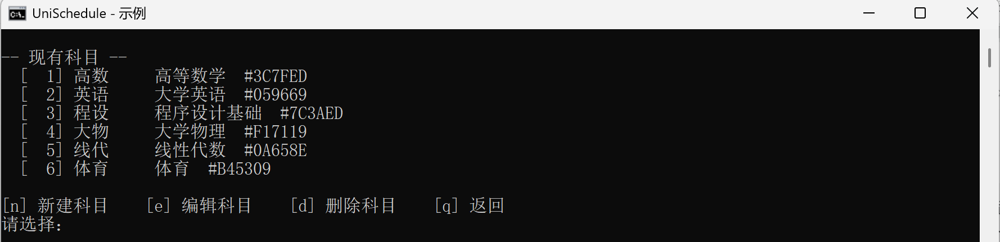

### [2] 管理课表

`[2]` 录入 / 编辑 / 删除整条，`[p]` 按科目 + 星期 + 节次精确删除：

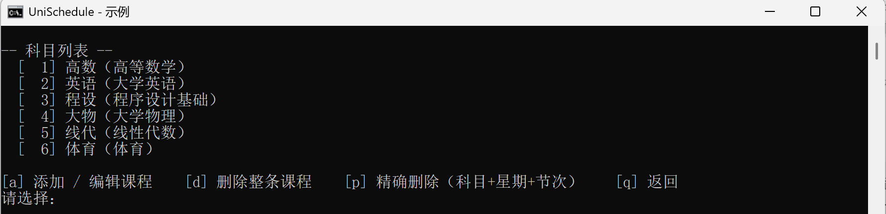

### [3] 启动课表显示

启动顶部横条；会询问模拟日期（直接回车 = 今天）。横条常驻置顶、鼠标穿透，可由托盘关闭或退出。


### [4] 清除所有数据

清除所有课表来源（手动 + ICS）与假期，输入 `clear` 确认；显示偏好（`[5]`）会保留。

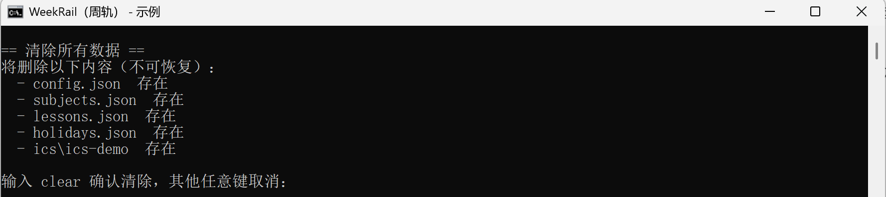

### [5] 显示设置

设置四档不透明度：非假期 / 假期 × 正常 / 悬停；直接回车保持不变，改完会立即重启横条生效。

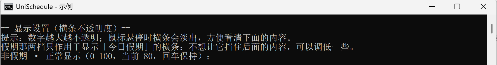

如果认为正常显示/鼠标穿透的课表不透明度过高，挡住了后面的内容，即可通过此设置调节。
### [6] 假期管理

添加 / 删除 / 查看假期段；整天没课的日期会自动显示「今日假期」。

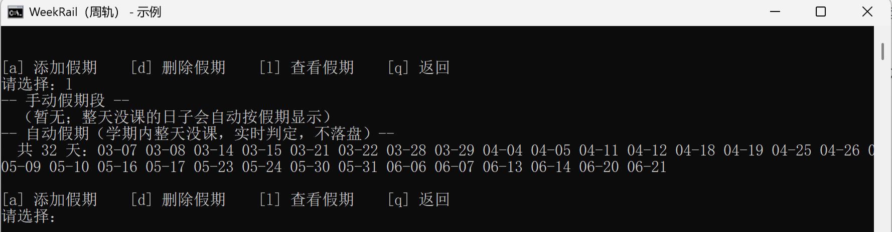

### [7] 查看课表

按课程输出自然语言课表，自动合并周次 / 星期 / 节次：

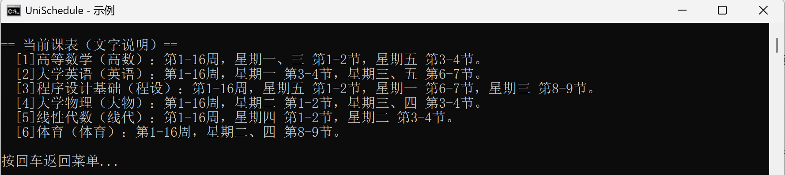

### [8] 课表来源

如果不想手动录入全部课程，也支持从 BitUp（哔特）或 BIT101 等软件导出的 ics 文件进行导入操作。

**重要：请在项目目录的 `课表ics` 文件夹中放入 ICS 文件；没有该文件夹时程序会自动创建，并提示完整路径。**

`[8] 课表来源` 提供：

- `i` 导入 / 重新导入 ICS：列出 `课表ics/` 下的文件，显示解析摘要，可先把第 1 周重定义到某个周一，确认后导入。
- `s` 切换来源：手动课表与各个 ICS 课表之间切换。
- `l` 查看来源：原始文件、导入时间、学期设置。
- `d` 删除 ICS 来源：只删导入的数据，原始 `.ics` 不动。

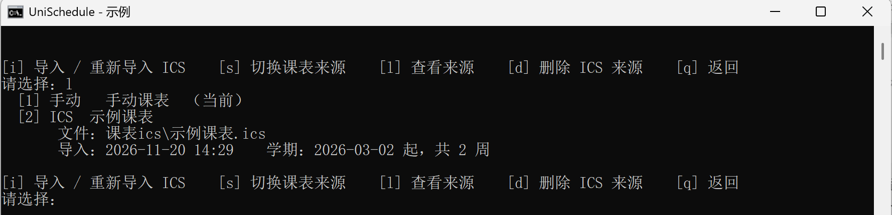

导入完成后会**逐门询问横条简称**（回车保持自动生成的 2–4 字简称，输入则覆盖）。

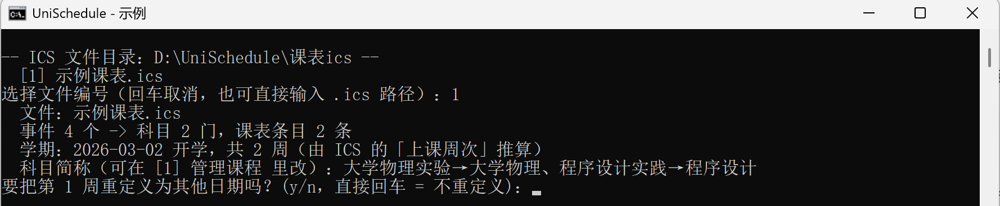

每个来源独立保存：手动课表在 `data/`，ICS 课表在 `data/ics/<id>/`，各自带学期配置；切换来源不会影响其它来源。

#### 导入 ICS 之后还能编辑吗？改动存在哪？

- **能。** ICS 导入后会变成一套普通课表来源，`[1]`/`[2]`/`[7]`/`[9]` 都直接作用于它（课程、简称、颜色、课表条目、精确删除、周次重定义）。
- `[5] 显示设置`（不透明度）和 `[6] 假期` 是全局设置，对所有来源生效。
- 改动保存在 `data/ics/<来源id>/` 的 `config.json` / `subjects.json` / `lessons.json`，**不是原始 `.ics`**；`课表ics/` 里的原始文件不会被修改。
- 第二次启动、或切到别的来源再切回来，读取的都是这些 JSON，**不会重新解析 `.ics`**，所以编辑不会丢。
- 只有你在 `[8] → i` 里再次选择同一个 `.ics` 并确认「重新导入」时，才会用 ICS 重新生成并**覆盖该来源的全部修改**（课表、简称、颜色都会重置）。
- 想保留现有编辑、再导入一份新的：把 `.ics` 复制成另一个文件名再导入，会创建一个新来源。

### [9] 重定义第 1 周

把第 1 周的定义改到另一个周一（只接受周一），当前来源的课表周次会整体平移（仅重定义当周的周次，不改动所有日期与课表的对应关系）；开学前的周显示为 `第-1周`、`第-2周`、`第-3周`……导入 ICS 时也会询问。

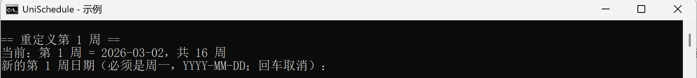

>说明：不同 App 导出的 ics 对第 1 周的定义不同，学校课表口径下的第 `X` 周可能在部分 ics 设置下，显示为第 `X+offset` 周，原因是定义了不同的开学日期；此时可通过此功能进行调节，输入学校课表口径下的第 1 周周一日期，即可将课表周次口径与学校课表口径对齐。

>举例：学校课表口径下，开学日期为 2026-09-21，部分课表 ics 口径下，开学日期为 2026-08-31，导致学校课表中第9周在部分课表下显示为第12周，此时在此功能下，输入 2026-09-21，即可统一到学校课表口径，在此日期前的周次会显示为负周次。

## 节次时间表

ICS 里的时间通过根目录 **`period_times.json`** 换算成节次。默认是北京理工大学 13 节时间表；换学校时修改这个文件后重新导入即可。

## 学期与周次

- 当前周 = `(今天 − 开学日) // 7 + 1`。
- 开学前的周不显示第 0 周：紧邻第 1 周之前显示 `第-1周`，更早依次为 `第-2周`、`第-3周`……
- `[9] 重定义第 1 周` 只接受**周一**（非周一直接拒绝），会把当前来源的课表周次整体平移，并更新学期配置。
- 导入 ICS 时也会询问是否重定义第 1 周。

## 课表横条与托盘

- 横条贴在屏幕顶部、始终置顶、鼠标穿透；鼠标移到上面会按 `[5]` 的设置变淡。
- 放假（手动假期或当天整天没课）时不显示 13 节，显示绿色「今日假期」。
- 托盘图标右键：显示 / 隐藏主窗口、启动 / 关闭课表横条、退出 WeekRail。终端最小化约 0.2 秒后自动隐藏。
- 开机自启：`Win + R` 输入 `shell:startup`，把 `autostart.bat` 的快捷方式放进打开的文件夹。

## 依赖

- **Python 3.10+（64 位）**，其余使用标准库。
- `requirements.txt`：

  ```text
  PySide6>=6.5,<7
  pystray>=0.19
  Pillow>=9
  ```

| 包 | 用途 | 安装后占用 |
|----|------|-----------|
| **PySide6**（含 shiboken6） | 横条界面 | **≈ 635 MB** |
| **Pillow** | 托盘图标 / 图片处理 | **≈ 15 MB** |
| **pystray** | 系统托盘图标 | **< 1 MB** |

安装后合计约 **650 MB**，首次安装请预留约 **700 MB**。Python 3.14 会自动使用 PySide6 6.11+。

## 开机启动

经过初始化之后，强烈推荐将`autostart.bat`加入开机启动菜单内。该脚本核心功能与`launcher.bat`基本相同，并且会一键启动课表横条并自动隐藏 conhost 终端窗口（可在托盘图标右键重新打开；若找不到托盘图标，点击展开按钮）。

1. 按下 `Win + R` 键打开“运行”窗口。
2. 输入 `shell:startup` 并回车，即可打开当前用户的启动文件夹。
3. 右键新建“新快捷方式”，浏览到`autostart.bat`，点击确认即可。这样，`autostart.bat`将在下一次计算机登录当前用户后自动启动`autostart.bat`并显示课表横条。（**注意放入`shell:startup`文件夹内的是指向`autostart.bat`的快捷方式而非`autostart.bat`本体！**）

## 数据与隐私

- 个人课表保存在 `data/`，ICS 文件放在 `课表ics/`；两者都在 `.gitignore` 中，不会被提交。
- `outputs/`、`*.bak*`、`__pycache__/` 同样不会进入仓库。
- 备份：升级或修改数据前可自行复制 `data/` 目录。

## 目录结构

```text
WeekRail/
├── launcher.bat / autostart.bat   启动（含经典 conhost 单窗口）
├── launcher.py                   终端菜单循环
├── display.py                    课表横条（PySide6）
├── tray_win.py                   托盘图标与终端隐藏
├── storage.py / sources.py       数据层与课表来源
├── period_times.json              节次 ↔ 时间对照表
├── ics_import.py                  ICS 解析与导入
├── manage_*.py                   课程 / 课表 / 假期 / 来源菜单
├── holidays.py / timetable.py    假期判定 / 文字课表
├── requirements.txt              Python 依赖
├── docs/                         README 配图
└── data/                         个人数据（不进入 Git）
```
